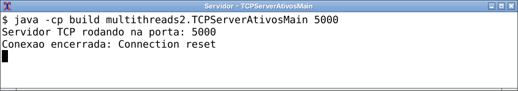
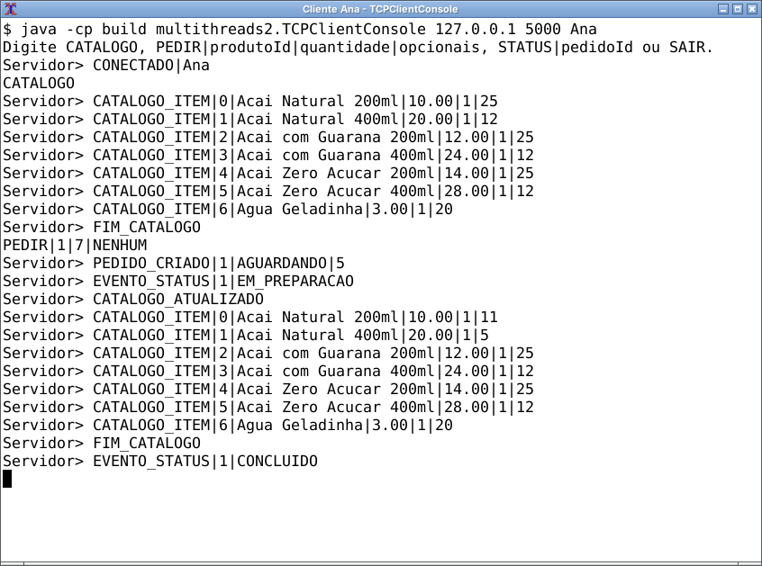
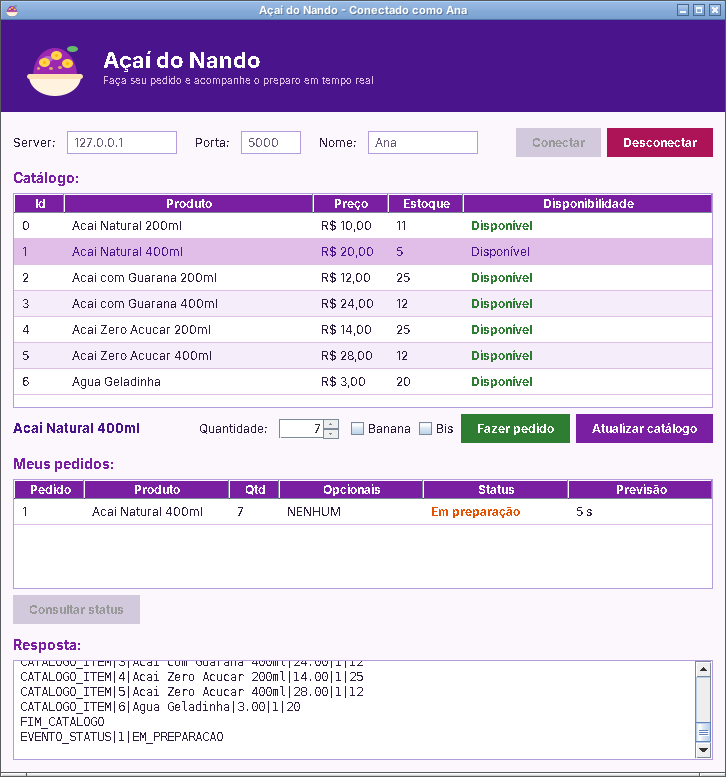
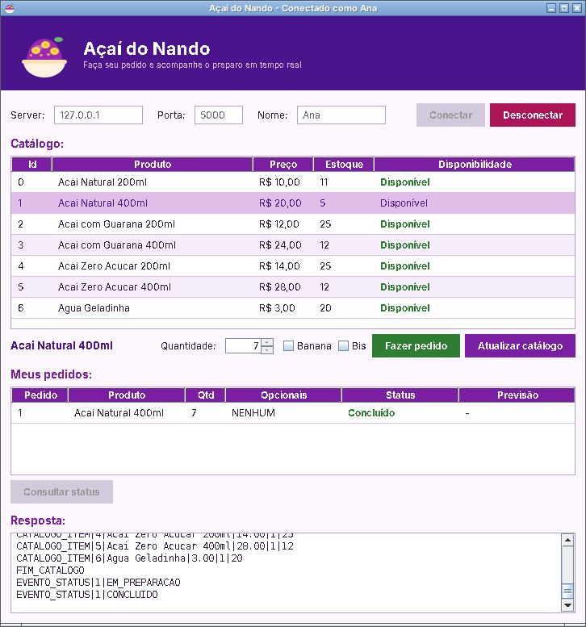
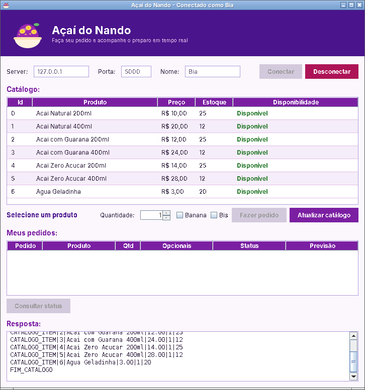
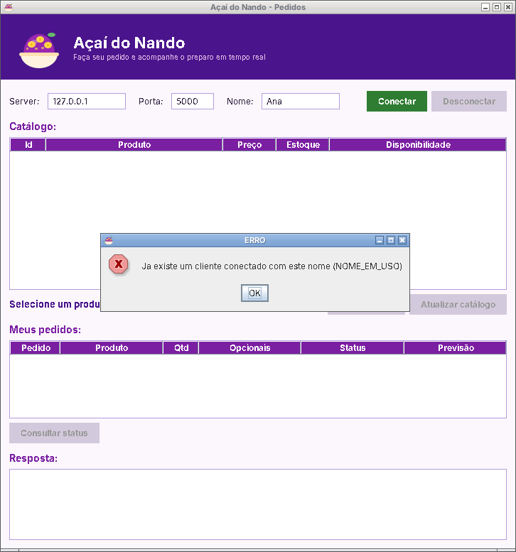

# Resultados dos testes: Açaí do Nando (Grupo 11)

Evidências colhidas executando o código de verdade (commit `751f7cb`, branch
`feature/cliente-gui`). Nenhum arquivo em `src/` foi alterado. Quando algo saiu
diferente do esperado, o código **não** foi corrigido: a divergência está
registrada como aconteceu.

**Placar: 14 de 15 testes passaram.** O único que falhou foi o T2, na parte do
`CONECTAR|` vazio. O T12 acertou 30 de 30 rodadas.

## Ambiente

| Item | Valor |
|---|---|
| SO | Ubuntu 24.04.5 LTS (container na nuvem) |
| JDK | OpenJDK 21.0.12, compilado com `javac --release 8 -encoding UTF-8 -d build src/multithreads2/*.java` |
| Cliente de teste | Python 3.13 com `socket` cru (`testes_acai.py`) |
| Telas | Xvfb + openbox + xterm (DejaVu Sans Mono 12) + xdotool + ImageMagick `import` |
| IP não-loopback | `192.0.2.2` (saída de `hostname -I`) |

A variável `JAVA_TOOL_OPTIONS` do container (configuração de proxy) foi removida
ao rodar o Java, porque ela só imprime a linha "Picked up JAVA_TOOL_OPTIONS..." no
console e não afeta o sistema.

## Arquivos

| Arquivo | Conteúdo |
|---|---|
| `testes_acai.py` | Script de T1 a T14: sobe o servidor, abre os sockets e registra cada linha |
| `log_completo.log` | Todas as linhas enviadas (`>>`) e recebidas (`<<`) de todos os clientes, a saída do servidor (`::`) e os veredictos |
| `dialogo_ana.log` | Só as linhas da Ana (incluindo a reconexão `Ana#2` no T14) |
| `resultados.json` | Veredicto de cada teste, tempos do T7 e as 30 rodadas do T12 |
| `capturas_console.py` | Gera `fig_servidor.png` e `fig_cliente_console.png` (comandos digitados com `xdotool type`) |
| `capturas_gui.py` | Gera as figuras da GUI, operando três janelas reais do `TCPClientForm` com mouse e teclado |
| `fig_*.png` | Prints recortados na janela |

Formato do log: `+  segundos  [cliente]  direção  linha`, com o tempo contado a
partir do início da execução. Para reproduzir, rode a partir da raiz do repositório:

```bash
python3 resultados-testes/testes_acai.py --compilar
```

## Tabela de testes

| Teste | Esperado | Obtido | Resultado |
|---|---|---|---|
| **T1** Conexão | Ana e Bia recebem `CONECTADO\|nome` | `CONECTADO\|Ana` e `CONECTADO\|Bia` | ✅ Passou |
| **T2** Nome repetido / vazio | `CONECTAR\|ana` → `ERRO\|NOME_EM_USO`; `CONECTAR\|` → `ERRO\|NOME_INVALIDO` | `CONECTAR\|ana` → `ERRO\|NOME_EM_USO\|Ja existe um cliente conectado com este nome` (a comparação ignora maiúsculas). **`CONECTAR\|` → `ERRO\|NAO_CONECTADO\|Envie CONECTAR\|nome antes dos comandos`**. Teste extra: `CONECTAR\| ` (com um espaço) → `ERRO\|NOME_INVALIDO` | ❌ Falhou (parcial) |
| **T3** Sem identificação | `ERRO\|NAO_CONECTADO` | `ERRO\|NAO_CONECTADO\|Envie CONECTAR\|nome antes dos comandos` | ✅ Passou |
| **T4** Catálogo | 7 `CATALOGO_ITEM` disponíveis (25/12/20) + `FIM_CATALOGO` | 7 itens, todos com `disponivel=1`, quantidades `25,12,25,12,25,12,20`, e `FIM_CATALOGO` | ✅ Passou |
| **T5** Pedido aceito | `PEDIDO_CRIADO\|1\|AGUARDANDO\|5`; Ana e Bia recebem `CATALOGO_ATUALIZADO` com item 0 = 11 e item 1 = 5 | `PEDIDO_CRIADO\|1\|AGUARDANDO\|5` em 1,6 ms; Ana e Bia receberam `CATALOGO_ATUALIZADO` com `11,5,25,12,25,12,20` | ✅ Passou |
| **T6** Estoque compartilhado | Bia: `ERRO\|SEM_ESTOQUE` | `ERRO\|SEM_ESTOQUE\|Estoque insuficiente para este pedido` (enviado menos de 1 ms depois do pedido da Ana) | ✅ Passou |
| **T7** Notificações | `EVENTO_STATUS\|1\|EM_PREPARACAO` e, ~5 s depois, `EVENTO_STATUS\|1\|CONCLUIDO` | As duas chegaram, com 4,959 s de intervalo (tempos abaixo) | ✅ Passou |
| **T8** Consulta | Ana: `STATUS_PEDIDO\|1\|CONCLUIDO\|5`; Bia: `ERRO\|PEDIDO_NAO_ENCONTRADO` | Exatamente esses | ✅ Passou |
| **T9** Opcional | Pedido aceito; banana passa de 20 para 19 | `PEDIR\|0\|1\|BANANA` → `PEDIDO_CRIADO\|2\|AGUARDANDO\|3`. Verificação indireta: `PEDIR\|4\|20\|BANANA` → `SEM_ESTOQUE` e `PEDIR\|4\|19\|BANANA` → `PEDIDO_CRIADO\|3`, logo restavam exatamente 19 | ✅ Passou (ver divergência 5) |
| **T10** Opcional inválido | `ERRO\|OPCIONAL_INVALIDO` | `ERRO\|OPCIONAL_INVALIDO\|Agua Geladinha nao aceita opcionais` | ✅ Passou |
| **T11** Validações | `PRODUTO_INVALIDO`, `QUANTIDADE_INVALIDA`, `FORMATO_INVALIDO`, `COMANDO_INVALIDO` | Os mesmos, na mesma ordem | ✅ Passou |
| **T12** Concorrência | Em cada rodada, exatamente um `PEDIDO_CRIADO` e um `SEM_ESTOQUE` | **30/30** rodadas corretas, com o servidor reiniciado a cada rodada | ✅ Passou |
| **T13** Rede (simulada) | Cliente conecta por um IP que não é loopback | Socket `192.0.2.2:51316 → 192.0.2.2:5000`; `CONECTADO\|Caio`; catálogo com 7 itens | ✅ Passou (simulação) |
| **T14** Saída e queda | Nomes liberados; servidor continua atendendo | Bia enviou `SAIR` e o servidor fechou a conexão. Ana caiu com RST, e o servidor registrou `Conexao encerrada: Connection reset`. Dani (`TCPClientConsole`) foi morta com `kill -9`. Depois, `Ana`, `Bia` e `Dani` reconectaram com `CONECTADO`, e o catálogo continuou sendo servido | ✅ Passou |
| **T15** GUI | Catálogo carregado, pedido em "Meus pedidos", catálogo da Bia atualizado sozinho e diálogo de nome repetido | Tudo confirmado nos prints abaixo | ✅ Passou |

## T7: tempos medidos

Tempos medidos no cliente Python, a partir do envio de `PEDIR|1|7|NENHUM` pela Ana:

| Evento | Tempo desde o envio |
|---|---|
| `PEDIDO_CRIADO\|1\|AGUARDANDO\|5` | 1,6 ms |
| `EVENTO_STATUS\|1\|EM_PREPARACAO` | 44,0 ms |
| `EVENTO_STATUS\|1\|CONCLUIDO` | 5003,4 ms |
| **Intervalo de EM_PREPARACAO a CONCLUIDO** | **4959,3 ms** |

O preparo é um `Thread.sleep(5000)`. O intervalo ficou cerca de 40 ms abaixo de
5 s porque o `EM_PREPARACAO` chegou ~40 ms atrasado ao cliente (ver divergência 4).
Do envio até o `CONCLUIDO` foram 5,003 s.

## T12: placar de concorrência

Os dois clientes (P1 e P2) se conectam e esperam numa `threading.Barrier(2)`.
Liberados juntos, cada um envia `PEDIR|3|7|NENHUM` (2800 ml cada, 5600 ml no
total, contra 5000 ml de guaraná). O servidor foi reiniciado em cada rodada,
numa porta nova (5100 a 5129), para evitar a espera do TIME_WAIT.

| Rodadas | Corretas | Venceu P1 | Venceu P2 | Defasagem entre os envios |
|---|---|---|---|---|
| 30 | **30** | 8 | 22 | 24 a 149 µs (mediana 49,5 µs) |

Em nenhuma rodada os dois pedidos foram aceitos, nem os dois recusados. O
`synchronized` em `PedidoService.processar` serializou a verificação e a baixa do
estoque. A preferência pelo P2 vem só da ordem em que as threads do script saem
da barreira; não é um defeito. As linhas de cada rodada estão no fim do
`log_completo.log` e em `resultados.json`.

## Divergências

1. **T2: `CONECTAR|` vazio devolve `NAO_CONECTADO`, não `NOME_INVALIDO`.** Em
   `TCPServerAtivosHandler`, o teste é
   `mensagem.startsWith("CONECTAR|") && mensagem.length() > 9`. Como `"CONECTAR|"`
   tem exatamente 9 caracteres, a mensagem cai no `else`, que responde
   `ERRO|NAO_CONECTADO|...`. O ramo `NOME_INVALIDO` só é alcançado com um nome que
   fica vazio depois do `trim()` (por exemplo `CONECTAR| `) ou que contém `|`. Na
   GUI isso não aparece, porque o `TCPClientForm` recusa o nome vazio antes de
   conectar ("Informe um nome sem o caractere |").
2. **`CATALOGO_ATUALIZADO` também vai para conexões que não se identificaram.**
   Os sockets `Outro` (que só teve `CONECTAR` recusado) e `Cru` (que nunca enviou
   `CONECTAR`) receberam os broadcasts do T5 e do T9. A causa é que
   `notificarCatalogoAtualizado()` percorre a lista `clientes`, onde toda conexão
   aceita entra no `accept()`, antes do `CONECTAR`. Isso não quebra nenhum teste,
   mas contradiz o T3: um cliente que não pode pedir `CATALOGO` recebe o catálogo
   mesmo assim.
3. **A ordem entre `EVENTO_STATUS|..|EM_PREPARACAO` e `CATALOGO_ATUALIZADO` varia
   de uma execução para outra.** No script, a Ana recebeu
   `PEDIDO_CRIADO → CATALOGO_ATUALIZADO → EM_PREPARACAO`. No print do console
   (`fig_cliente_console.png`), recebeu `PEDIDO_CRIADO → EM_PREPARACAO →
   CATALOGO_ATUALIZADO`. São duas threads diferentes (o handler, que faz o
   broadcast, e o `PedidoService`, que envia o evento) disputando a mesma conexão.
   O `PEDIDO_CRIADO` sempre chega primeiro, como o comentário do código garante.
   Diagramas de sequência no relatório não devem fixar a ordem das outras duas.
4. **Respostas de várias linhas chegam em duas levas, com ~40 ms entre elas.** Em
   todo `CATALOGO`, o primeiro `CATALOGO_ITEM` chega na hora e os demais ~40 ms
   depois (por exemplo 0,073 s e 0,113 s no T4). O `PrintWriter` tem *autoflush*,
   então cada `println` vira um segmento TCP. O algoritmo de Nagle segura o
   segundo segmento até chegar o ACK, e o cliente atrasa o ACK em ~40 ms (*delayed
   ACK*). É o mesmo efeito que atrasa o `EM_PREPARACAO` no T7. Não é um erro
   funcional, mas explica a latência medida.
5. **T9: o estoque de banana não aparece no protocolo.** `CATALOGO_ITEM` só traz
   os açaís e a água, então não dá para ver o "20 → 19" diretamente. Ele foi
   confirmado de forma indireta com o Açaí Zero, que ainda tinha 5000 ml, de modo
   que só a banana podia faltar: 20 unidades com banana foram recusadas
   (`SEM_ESTOQUE`) e 19 foram aceitas.
6. **Instrução de execução da GUI.** `TCPClientMain` **não tem** `main`: é a
   classe de conexão. A GUI é iniciada com
   `java -cp build multithreads2.TCPClientForm`. O cliente de console usa
   `TCPClientConsole <ip> <porta> <nome>`, com os padrões `127.0.0.1`, `5000` e
   `ClienteConsole`.
7. **O console do servidor registra pouco.** Ele imprime só
   `Servidor TCP rodando na porta: N` e, quando um cliente cai com RST,
   `Conexao encerrada: Connection reset`. `SAIR` e o encerramento por FIN (cliente
   morto com `kill -9`) não deixam nenhuma linha. Por isso `fig_servidor.png` tem
   só três linhas: é assim que o servidor funciona.
8. **T13 é uma simulação.** Cliente e servidor rodaram no mesmo container. A
   conexão usou a interface de rede `192.0.2.2` em vez de `127.0.0.1`, mas não
   cruzou uma rede física entre duas máquinas.

Observação sobre o próprio script (não é divergência do sistema): na primeira
execução, o T14 acusou que o nome "Ana" não tinha sido liberado. A causa estava
no script: em Python, `socket.close()` não fecha o descritor enquanto o arquivo
de `makefile()` continua aberto, então o RST nunca era enviado. O `derrubar()`
foi corrigido e os logs entregues são da execução corrigida.

## Prints

As capturas vêm de execuções próprias (servidor novo em cada uma), separadas da
execução do script. Os comandos e cliques foram feitos com `xdotool` nos
programas reais.

### Console do servidor (`fig_servidor.png`)


### Cliente de console da Ana: T4 + T5 + T7 (`fig_cliente_console.png`)
`CATALOGO` e `PEDIR|1|7|NENHUM` foram digitados no xterm. A Bia estava conectada
por um socket à parte.


### GUI da Ana com o pedido em preparação (`fig_gui.png`)


### GUI da Ana com o pedido concluído (`fig_gui_concluido.png`)


### GUI da Bia antes e depois do pedido da Ana (`fig_gui_bia_antes.png`, `fig_gui_bia.png`)
Ninguém clicou na janela da Bia entre as duas capturas. O estoque dos itens 0 e 1
passou de 25/12 para 11/5 só com o `CATALOGO_ATUALIZADO` enviado pelo servidor.

| Antes | Depois |
|---|---|
|  |  |

### T2 na GUI: nome repetido (`fig_gui_erro_nome.png`)
Uma terceira janela tentou conectar como "Ana" enquanto a Ana estava conectada.

